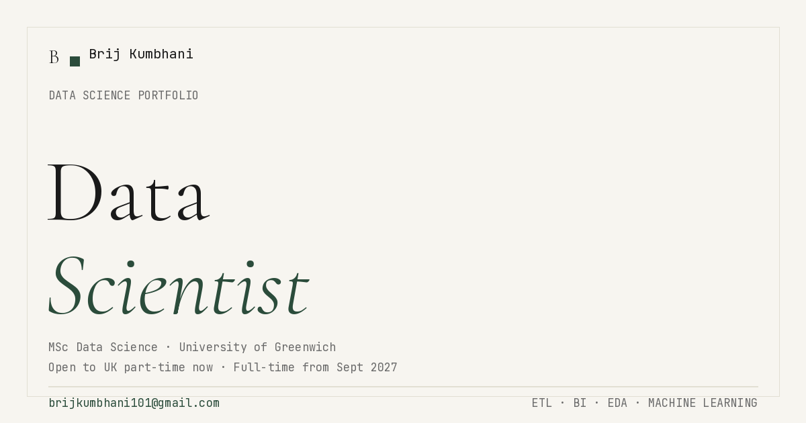

# Brij Kumbhani — Data Science Portfolio

> Live site: **https://brij-kumbhani-portfolio.vercel.app**

A recruiter-focused personal portfolio positioning me as an early-career **Data Scientist** — MSc Data Science @ University of Greenwich. Built as a full-stack app: a React frontend, a FastAPI backend with a real contact form, and a MongoDB database — deployed end-to-end on a £0/month stack.



## What's inside

- **Kinetic hero** — masked line-by-line headline reveal, framed headshot, availability stat strip, CTAs (View Projects / Download CV / Email me)
- **About** — bio, experience timeline, education, and a grouped skills taxonomy (no fake percentage bars)
- **5 curated project case studies** — each with a real dashboard screenshot and a Problem → Dataset → Approach → Stack → Result writeup
- **Writing** — a small blog rendered from local markdown content (3 posts: ETL lessons, Netflix EDA, mental-health-in-tech EDA), with code blocks and reading time
- **Contact form** — validated, honeypot-protected, rate-limited (3/hour per IP), emails me via Resend and stores a backup in MongoDB
- **Dark mode** — no-flash theme toggle (inline pre-paint script + localStorage)
- **SEO** — per-page titles, OG share image, Person structured data, robots.txt

## Tech stack

| Layer | Tech | Hosting |
|---|---|---|
| Frontend | React 19, Tailwind CSS, Framer Motion, Lenis, React Router | Vercel (free) |
| Backend | FastAPI (Python), Motor (async MongoDB) | Render (free) |
| Database | MongoDB | Atlas M0 (free) |
| Email | Resend (server-side only) | Resend free tier |

## Project structure

```
├── backend/
│   ├── server.py            # POST /api/contact + GET /api/health
│   └── requirements.txt
└── frontend/
    ├── public/              # CV pdf, og-image, headshot, favicon, robots.txt
    └── src/
        ├── sections/        # Hero, About, Projects, WritingPreview, Contact
        ├── pages/           # Home, Writing, WritingPost, ProjectCase
        ├── components/      # Nav, Footer, Logo, ThemeToggle, Meta, ...
        ├── data/projects.js # The 5 case studies
        └── content/writing/ # Blog posts
```

## Run locally

**Backend**
```bash
cd backend
pip install -r requirements.txt
# create backend/.env with: MONGO_URL, DB_NAME, OWNER_EMAIL, RESEND_API_KEY
uvicorn server:app --host 0.0.0.0 --port 8001 --reload
```

**Frontend**
```bash
cd frontend
yarn install
# create frontend/.env with: REACT_APP_BACKEND_URL=http://localhost:8001
yarn start
```

## Environment variables

**Backend** — `MONGO_URL`, `DB_NAME`, `OWNER_EMAIL`, `RESEND_API_KEY`, `RESEND_FROM`, `EMAIL_FROM_NAME`, `EMAIL_REPLY_TO`, `CORS_ORIGINS`
**Frontend** — `REACT_APP_BACKEND_URL`

---

**Brij Kumbhani** · MSc Data Science, University of Greenwich · Open to UK part-time roles now, full-time from Sept 2027
[Portfolio](https://brij-kumbhani-portfolio.vercel.app) · [LinkedIn](https://www.linkedin.com/in/brij-kumbhani/) · [Email](mailto:brijkumbhani101@gmail.com)
